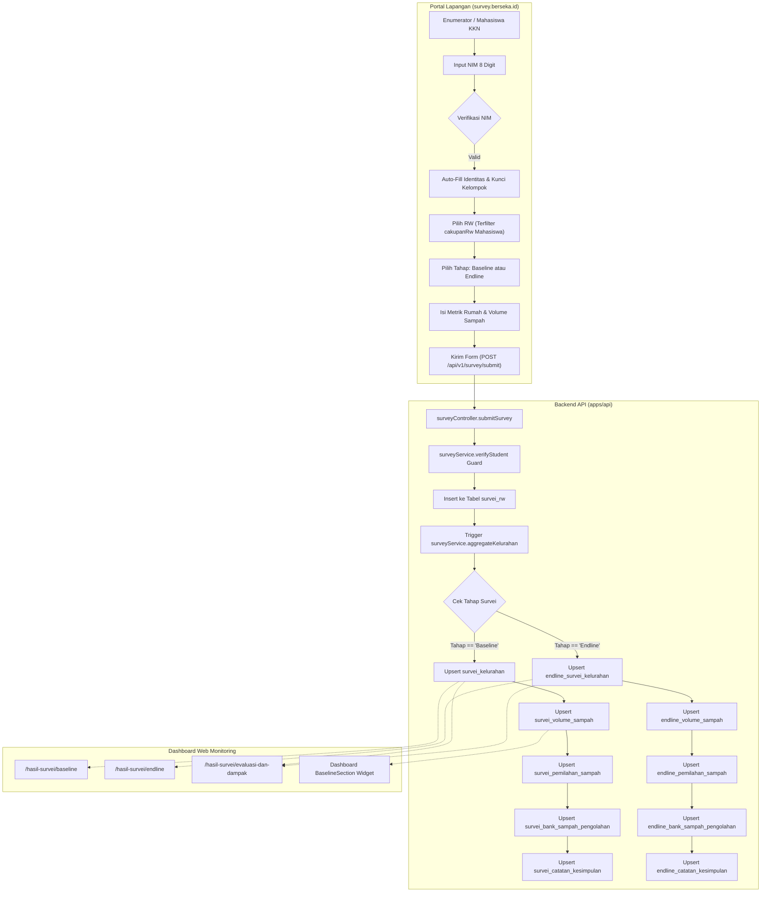
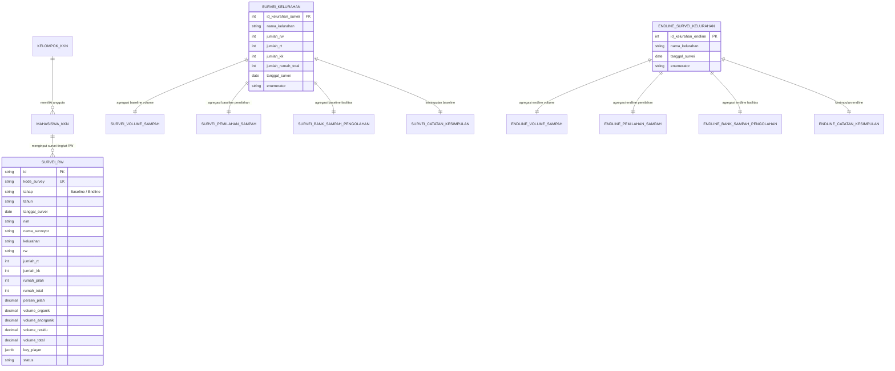

# LAPORAN RESMI TEKNIS: FITUR, FUNGSI, ALUR, DAN RELASI SISTEM SURVEI BERSEKA

**Proyek:** Sistem Tata Kelola Sampah Cerdas BERSEKA (UNIKOM & PT Makerindo)  
**Tanggal:** 30 Oktober 2026  
**Status QC:** 🟢 **LULUS (0 Error, 100% Type-Safe & Test-Passed)**  
**Target Lingkungan:** `development` ➡️ `staging` ➡️ `main` (VPS Production)

---

## 1. Ringkasan Eksekutif & Resolusi Masalah Baseline

Sebelumnya, pengisian data survei tahap **Baseline (Awal)** tidak masuk ke dalam sistem dan tabel agregasi kelurahan. Investigasi menyeluruh menemukan 4 akar masalah teknis:
1. **Ketidakhadiran Tabel `survei_rw`**: Migrasi DDL `20261029150000_add_survei_rw_table` belum dieksekusi di database server, menyebabkan Prisma melempar error `relation "survei_rw" does not exist`.
2. **Ketiadaan Agregasi Baseline di Backend**: Pada `surveyService.ts`, fungsi `aggregateKelurahan()` hanya memproses `if (tahap === "Endline")` dan mengabaikan tahap `Baseline`, sehingga tabel `SurveiKelurahan`, `SurveiVolumeSampah`, dan `SurveiPemilahanSampah` tidak pernah terbarui.
3. **Mismatched Content-Type**: Form frontend mengirim header `text/plain` peninggalan Google Apps Script sehingga `req.body` kosong di backend Express.
4. **Inkonsistensi ID & Penamaan Kelurahan**: Fallback ID kelurahan tertukar dan perbedaan penamaan (`Lebak Gede` vs `Lebakgede`).

Seluruh masalah tersebut telah diperbaiki, tabel `survei_rw` telah resmi dimigrasikan ke PostgreSQL server VPS (`psc_db`) setelah penciptaan *Golden Backup*, dan logika agregasi otomatis dua arah (Baseline & Endline) telah diimplementasikan penuh.

---

## 2. Fitur & Fungsi Sistem Survei

### A. Form Survei Publik (`survey.berseka.id` / `/survey`)
- **Verifikasi Real-Time Mahasiswa KKN**: Mahasiswa memasukkan 8 digit NIM. Sistem memverifikasi ke database `StudentKkn` dan mengunci (*disabled*) pilihan nama, prodi, dan kelompok KKN resmi, serta membatasi pilihan RW hanya pada `cakupanRw` wilayah binaan mahasiswa tersebut.
- **Dua Tahap Pengukuran (Dual-Mode)**:
  - **Baseline (Awal)**: Pengukuran kondisi awal sebelum intervensi program kerja KKN.
  - **Endline (Akhir)**: Pengukuran dampak evaluasi pasca-intervensi program KKN.
- **Kalkulasi Otomatis di Sisi Klien**:
  - Persentase pemilahan sampah: \(\frac{\text{Rumah Memilah}}{\text{Total Rumah}} \times 100\%\).
  - Klasifikasi tingkat pemilahan dinamis (*Belum Ada*, *Sebagian Kecil*, *Sebagian Besar*, *Mayoritas*).
  - Total volume timbulan sampah harian (\(\text{Organik} + \text{Anorganik} + \text{Residu}\)).
  - Peringatan anomali data (misal volume sampah per rumah di luar batas wajar 0,3–3 kg/hari).
- **Tab Data Masuk & Ekspor Fleksibel**:
  - Menampilkan ringkasan metrik total survei, baseline, endline, dan jumlah RW terjangkau.
  - Tabel rekap volume sampah per kelurahan.
  - Tabel rincian survei per RW dengan status sinkronisasi server (`Tersimpan DB`).
  - Fitur ekspor CSV dan JSON langsung dari dataset server (dengan fallback lokal offline).

### B. Dashboard Web Admin & Eksekutif
- **Arsip Survei Baseline (`/hasil-survei/baseline`)**: Menampilkan daftar kelurahan beserta metrik baseline (RW, RT, persentase pemilahan, volume sampah).
- **Arsip Survei Endline (`/hasil-survei/endline`)**: Menampilkan daftar capaian akhir setelah kegiatan KKN.
- **Evaluasi dan Dampak (`/hasil-survei/evaluasi-dan-dampak`)**: Membandingkan secara langsung (*side-by-side*) data Baseline vs Endline per kelurahan untuk mengukur kenaikan kepatuhan dan reduksi sampah.
- **Widget Dashboard Utama (`BaselineSection.tsx`)**: Mengonsumsi data baseline resmi untuk acuan grafik kinerja tata kelola sampah se-Kecamatan Coblong.

---

## 3. Diagram Alur Sistem (Data Flow & Architecture)



---

## 4. Skema & Relasi Database (Entity-Relationship Diagram)



---

## 5. Pemetaan Kelurahan & ID Database (Coblong)

Untuk menjamin tidak ada tumpang tindih data antar-kelurahan saat agregasi otomatis:

| ID Kelurahan | Nama Kelurahan Resmi | Cakupan RW Resmi | Target Mahasiswa KKN |
|---|---|---|---|
| **1** | **Sadang Serang** | 13 RW | Kelompok 21 – 26 |
| **2** | **Lebak Siliwangi** | 8 RW | Kelompok 17 – 20 |
| **3** | **Sekeloa** | 12 RW | Kelompok 27 – 32 |
| **4** | **Dago** | 15 RW | Kelompok 01 – 06 |
| **5** | **Lebak Gede** | 10 RW | Kelompok 13 – 16 |
| **6** | **Cipaganti** | 12 RW | Kelompok 07 – 12 |

---

## 6. Spesifikasi Endpoint API Modul Survei

| Method | Endpoint | Fungsi | Autentikasi / Proteksi |
|---|---|---|---|
| `GET` | `/api/v1/survey/verify-student?nim={nim}` | Validasi NIM mahasiswa KKN, ambil data kelompok & RW dampingan | Publik (Validasi regex NIM) |
| `GET` | `/api/v1/survey/kelompok-list` | Mengambil referensi seluruh kelompok KKN aktif | Publik |
| `POST` | `/api/v1/survey/submit` | Menyimpan entri survei RW & melakukan agregasi otomatis ke kelurahan | Publik (Wajib NIM valid) |
| `GET` | `/api/v1/survey/data?search={q}` | Mengambil rekap kelurahan & riwayat survei RW untuk tab Data Masuk | Publik |
| `DELETE` | `/api/v1/survey/:id` | Menghapus entri survei RW spesifik (jika ada kesalahan) | Publik / Admin |
| `GET` | `/api/v1/survei-kkn` | Mengambil data survei kelurahan (Baseline) | Terautentikasi (Web Dashboard) |
| `GET` | `/api/v1/evaluasi-dampak/endline` | Mengambil data survei kelurahan (Endline) | Terautentikasi (Web Dashboard) |
| `GET` | `/api/v1/waste/baseline` | Mengambil data baseline untuk widget dashboard | Terautentikasi (Web Dashboard) |

---

## 7. Hasil Uji QC (Quality Control Verification)

```text
[✓] Backend Type Check : cd apps/api && npx tsc --noEmit (0 error)
[✓] Web Frontend Check : cd apps/web && npx tsc --noEmit (0 error)
[✓] Unit Test Vitest   : 7/7 passed (src/controllers/survey.test.ts)
[✓] Database DDL Sync  : Tabel survei_rw terverifikasi di PostgreSQL (psc_db)
[✓] Golden Backup Dump : golden_backup_2026-10-29T11-01-39_pre_survei_rw.sql (669 MB)
[✓] Naming Governance  : Menggunakan 'Tempat Sampah', bebas kata terlarang 'tong'
```
